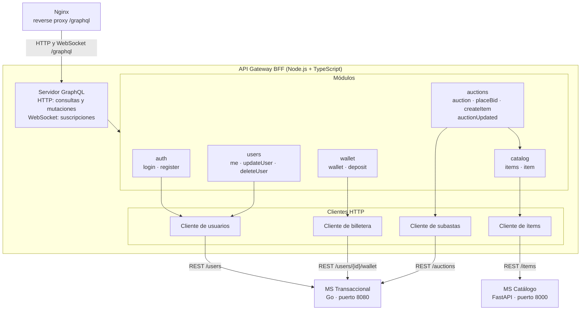
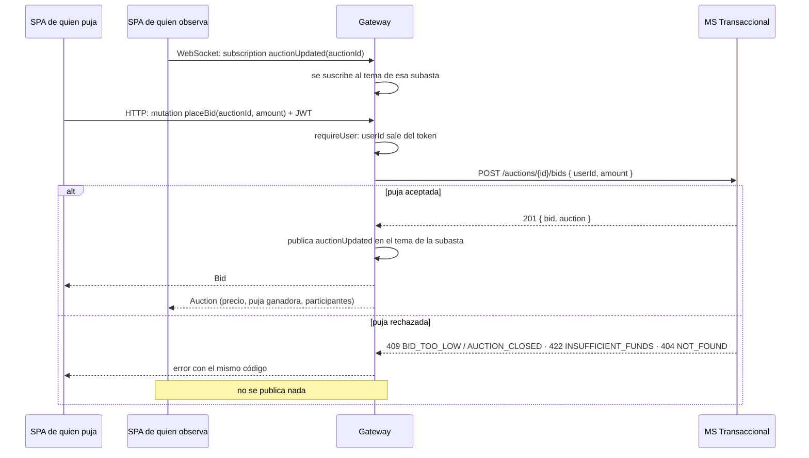

# Subarquitectura del API Gateway (BFF) - Pujaz

## Descripción

Esta vista abre el componente **API Gateway BFF** de la [vista C&C](vista-cc.md) y muestra cómo está organizado por dentro. El Gateway es el único punto de entrada de la SPA: recibe GraphQL por HTTP y suscripciones por WebSocket, valida el JWT y traduce cada operación a llamadas REST a los dos microservicios. No tiene base de datos.

Está escrito en **Node.js + TypeScript** con **GraphQL Yoga** y se organiza en tres niveles: el **servidor** recibe las peticiones, los **módulos** resuelven cada operación y los **clientes HTTP** hablan con cada microservicio.

## Diagrama

## Elementos

| Elemento | Responsabilidad |
|---|---|
| **Servidor GraphQL** | Recibe consultas y mutaciones por HTTP y suscripciones por WebSocket (`graphql-ws`) en `/graphql`. Lee el JWT de cada petición y obtiene el usuario. Todo error sale con uno de los códigos del contrato |
| **auth** | `login` y `register`: verifica credenciales en el MS transaccional y firma el JWT (HS256, 24 horas) |
| **users** | Perfil del usuario del token: `me`, `updateUser`, `deleteUser` |
| **wallet** | Billetera del usuario del token: `wallet` y `deposit` |
| **auctions** | Subastas y pujas: `auction`, `placeBid`, `createItem` y la suscripción `auctionUpdated`. Usa `catalog` para traer el ítem de cada subasta. Cuando una puja se acepta, avisa a quienes siguen esa subasta |
| **catalog** | Listado, búsqueda y detalle de ítems: `items`, `item` |
| **Clientes HTTP** | Uno por recurso del contrato REST (`docs/contrato/rest.md`). Envían JSON, esperan como máximo 5 s y validan cada respuesta contra el contrato |

## Relaciones

| Origen → destino | Conector | Para qué |
|---|---|---|
| Nginx → Servidor | HTTP y WebSocket en `/graphql` | Entrada única de la SPA; el JWT llega en `Authorization: Bearer` |
| Servidor → módulos | Llamada en el mismo proceso | Ejecutar cada operación con el usuario del token |
| `auctions` → `catalog` | Llamada en el mismo proceso | Completar el ítem de cada subasta y crear el ítem antes de su subasta |
| Módulos → clientes HTTP | Llamada en el mismo proceso | Pedir los datos al microservicio que corresponde |
| Clientes de usuarios, billetera y subastas → MS Transaccional | HTTP / REST JSON, puerto 8080 | Usuarios, saldo, subastas y pujas |
| Cliente de ítems → MS Catálogo | HTTP / REST JSON, puerto 8000 | Ítems |

Para desarrollar y probar sin los microservicios, cada cliente HTTP tiene una versión en memoria con los mismos datos de entrada y salida. La variable `USE_MOCKS` decide cuál se usa al arrancar, sin cambiar los módulos.

## Flujo de una puja en tiempo real

## Decisiones y limitaciones

- **Una sola copia del Gateway.** Los eventos se publican en memoria del proceso; con varias copias, un observador no vería las pujas hechas en otra. Escalar requeriría un bus de eventos externo.
- **El contrato manda.** Con los MS reales, cada respuesta se valida contra `rest.md`. Si falta algo obligatorio o el endpoint no existe, la operación responde `INTERNAL` y el log del Gateway indica qué falta; el Gateway no inventa datos.
- **El Gateway no guarda nada.** Usuarios, saldos, subastas, pujas e ítems viven en los MS. El Gateway solo firma y valida el JWT (HS256, 24 horas).
